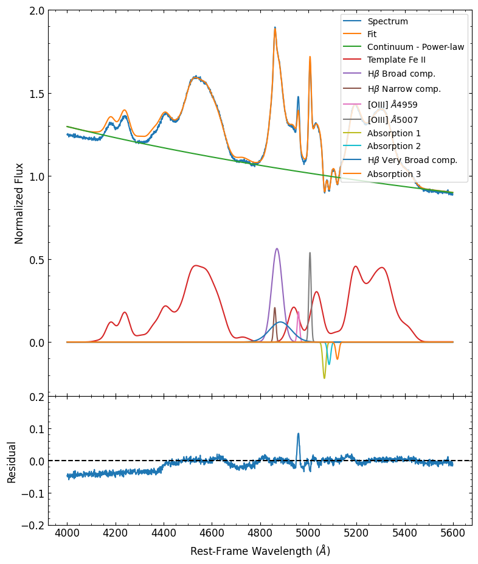

# Spectrum Fitter

Interactive decomposition of AGN emission lines — Hβ, Mg II, C IV, C III] — with
Fe II template fitting, built for rest-frame, continuum-normalized spectra.
Ships as a Streamlit app plus a programmatic API (`FSRQ_fit.Fit_Spec`) for batch
work.

Originally developed during a PhD on flat-spectrum radio quasars; this is a
revival of that code on a current Python stack (see `CHANGELOG.md`).

---

## Quick start

```bash
python -m venv .venv
./.venv/Scripts/python.exe -m pip install -r requirements.txt   # Windows
# source .venv/bin/activate && pip install -r requirements.txt  # Linux/macOS
```

`requirements.txt` states the intent (direct dependencies + why each pin is
load-bearing). `requirements-lock.txt` is `pip freeze` of the exact environment
this release was verified in — use that one if you need bit-for-bit
reproducibility.

./run.sh                # or: run.bat   , or:
./.venv/Scripts/python.exe -m streamlit run app.py
```

The app opens on <http://localhost:8501>.

**Launch from the repository root.** The templates are loaded through relative
paths (`Hierro/Carbono/...`), and exported `*_fit.txt` / `*.pdf` files are
written to the working directory.

On a fresh session the app asks for a spectrum and does nothing until you upload
one — that is deliberate, not a stall.

### Try it without your own data

Upload `testdata/ejemplo_Hbeta_OIII.txt` (rest frame, 4400-5600 Å, normalized),
choose `txt`, and pass `testdata/params_componentes.txt` as the component
parameter file. It contains four components (broad/narrow Hβ, [O III] 4959/5007)
with bounds already set.

---

## Inputs

**Spectrum**, either format:

- **`fits`** — needs the WCS keywords `CD1_1`, `CRPIX1`, `CRVAL1` in the primary
  header, as written by the Steward reduction pipeline. Assumed **rest frame and
  continuum-normalized**; a single 1-D flux array, no error array is read.
- **`txt`** — two whitespace-separated columns: wavelength (Å), flux.

**Component parameter file** (optional, "¿Desea usar archivo de parámetros para
las componentes?" → Sí). Whitespace-separated, one row per component:

```
prof_type amplitude center fwhm amin amax cmin cmax fmin fmax
```

`prof_type` is `g` (Gaussian) or `l` (Lorentzian); `fwhm` in km/s; the `*min`
/`*max` pairs are the fit bounds.

**Fe II template parameter file** (optional, requires "Utilizar un template de
Fe II" and "Sí" to the template-parameter question — the latter only exists for
the 4000-5500 Å multi-component range). Needs a `group` column with values
`f`, `g`, `p`, `s`, `zw`, plus `amp`, `shift`, and for group `f` the shared
Doppler width.

---

## Template grids (`Hierro/`)

`Hierro/` ("iron") holds the Fe II templates, grouped by the spectral range they
cover:

| folder | range | files | width axis |
|---|---|---|---|
| `Carbono/` (`FE_UV_A*.dat`) | 1435-2033 Å | 50 | index 1-50 |
| `Magnesio/` (`FE_UV_B*.dat`) | 2200-3400 Å | 50 | index 1-50 |
| `Hidrogeno/` (`FE_OPT-1_*.dat`) | 4000-7000 Å | 24 | index *i* = 700 + 100(*i*-1) km/s |
| `Hidrogeno/FeII_template_4000_5500_Kovacevic/` | 4000-5500 Å | 22 dirs | 700-2800 km/s in steps of 100 |

The optical grid has **24** entries by construction —
`Hierro/Hidrogeno/grid_conv.py` sweeps `np.arange(700, 3100, 100)`, so widths stop
at 3000 km/s. That script is the generator and it runs standalone: it used to
import `astroagn.lctools` for two conversions (`kmstoangs`, `fwhmtosigma`), now
defined inline. Run it from `Hierro/Hidrogeno/` and it writes to
`regenerated_grid/` so the shipped templates are never overwritten; the output
matches the published files to a maximum relative difference of 3e-10 (float64
round-off, plus a float-repr change in pandas since 2021). The app reads
whatever is present and sizes its smoothing slider accordingly; it does not
assume 50.

`Hierro/Hidrogeno/old/` holds a **different base atlas** for the optical range,
not a continuation of the current one (its profiles are not convolutions of
`FE_OPT-1_og.dat`). Don't mix the two.

---

## Programmatic use

```python
from astropy import units as u
from specutils.spectra import SpectralRegion
from FSRQ_fit import Fit_Spec

final_model, params, cont_params = Fit_Spec(
    L=wave, FLUX=flux,
    gaussians=gaussians,            # [[[init,min,max,fixed], [..], [..]], ...] centre/amp/FWHM
    exclContRegions=exclContRegions,
    hb_oiii=True,                   # tie narrow Hβ + [O III] 4959/5007
    feii_temp='4000-5500 Angstroms (Multiple components)',
    feii_params=feii_params,
    fit_window=SpectralRegion(4450*u.AA, 5480*u.AA),
)
```

`examples/example_local.ipynb` is a complete, self-contained walkthrough: it
loads a synthetic spectrum, fits it, and plots components, residuals and the Fe II
template. It runs out of the box.

```bash
python tools/run_notebook.py examples/example_local.ipynb
```



`examples/example_pks1510.ipynb` is the same analysis pointed at real PKS 1510-089
spectra. Those spectra are not distributed here — put your own `*_c.txt` files
somewhere and adjust the `glob` in the second code cell.

Run a notebook in the pinned environment (registers a kernelspec for the local
venv rather than whatever python is globally installed):

```bash
python tools/run_notebook.py examples/example_local.ipynb
```

---

## Tests

```bash
python tools/verify_fit_synthetic.py    # Fit_Spec vs known ground truth
python tools/test_app_states.py         # 7 widget states of the GUI
python tools/test_region_bounds.py      # 3 region-selection states
```

All three exit non-zero on failure and are what CI runs. They drive the real
Streamlit script through `streamlit.testing.v1.AppTest`, with the file uploader
stubbed.

---

## Known limitations

- **No uncertainties.** `Spectrum1D` is built from flux alone, so the fit is
  unweighted and no formal parameter errors are computed or exported. Use an
  external error propagation if you need them for publication.
- **Degenerate components.** Two Gaussians sharing a centre (e.g. broad and very
  broad Hβ) trade amplitude against width: the sum is constrained, the split is
  not.
- **Bounds bite.** With all 13 parameters free on a single 500-pixel epoch, the
  fitter can rail against several bounds. Retune the initial values per
  spectrum — that is what the GUI is for.
- **The `hb_oiii` tie is fixed** to the theoretical doublet ratio
  `I(4959) = I(5007)/2.947`, so the 4959 amplitude is derived, not measured.
- **Single epoch / single spectrum.** No error handling for masked pixels,
  telluric residuals, or multi-epoch simultaneous fitting.

## License

BSD 3-Clause — see [LICENSE](LICENSE).

Copyright (c) 2020-2026 R. Amaya-Almazán. Permissive: use it, modify it, ship it
commercially, just keep the copyright notice and don't use the author's or
contributors' names to endorse derived products.

## Credits

Original code and modelling: R. Amaya-Almazán (PhD work on FSRQs; see
Amaya-Almazán et al. and Chavushyan et al. for the science context).
